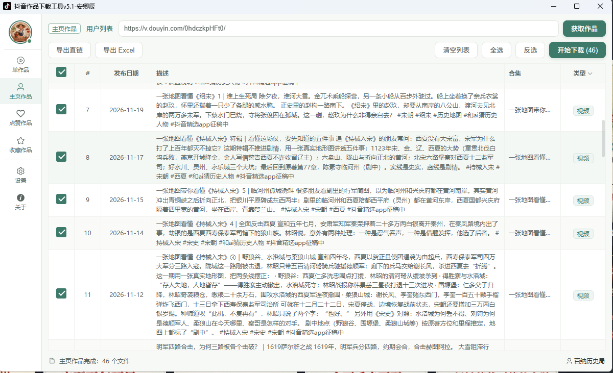
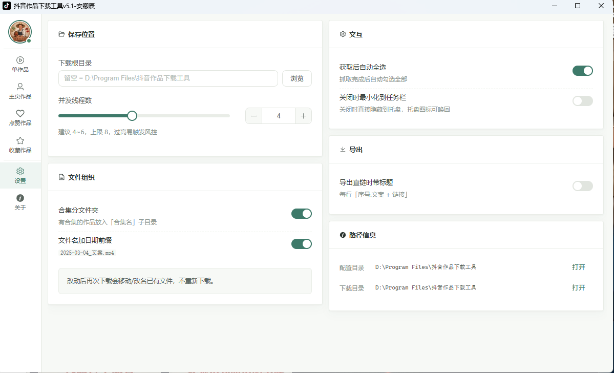
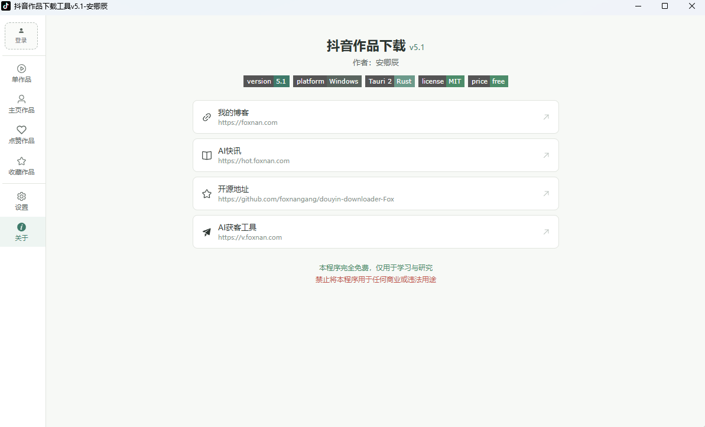

<div align="center">

# 抖音作品下载工具 - Fox

**抖音视频 / 图集 / 实况 批量下载 · 扫码登录 · 断点续传 · 在线更新**

作者：安卿辰 - FoxNan

[](#-下载安装)
[](#-下载安装)
[](#-下载安装)
[](#-声明)
[](#-在线更新)

</div>

---

## 简介

一款面向创作者的抖音作品批量下载桌面应用，主打「粘贴链接 → 勾选 → 下载」三步完成。

- 支持**主页作品、点赞作品、收藏作品、单作品**四种抓取模式
- 内嵌扫码登录，Cookie 自动保存，全程无需手动复制
- 批量下载带**断点续传**，中断后从断点继续，不浪费流量
- 内置**在线自动更新**，新版本启动时自动提示，一键升级
- 整个安装包约 3.4 MB，不依赖 aria2、ffmpeg 等任何外部组件

## 界面预览

<div align="center">



*主页作品批量抓取 · 统计条实时显示抓取 / 勾选 / 下载进度*



*保存路径、并发线程、文件组织方式均可自定义*



*关于页 · 墨绿主题 · 支持作者*

</div>

## 功能一览

| 功能 | 说明 |
| --- | --- |
| 四种抓取模式 | 单作品（视频 / 图集）、主页作品、点赞作品、收藏作品 |
| 扫码登录 | 内嵌浏览器打开抖音完成扫码，Cookie 自动保存与定期校验 |
| 批量下载 | 支持多用户批量获取，各用户作品自动分目录存放 |
| 断点续传 | 下载中断后保留临时文件，下次从断点继续 |
| 大列表优化 | 几千个作品一次抓全：智能分页终止、风控自动重试、内存平稳 |
| 类型过滤 | 按视频 / 图片 / 实况筛选，支持全选、反选、鼠标框选、Ctrl+A |
| 数据导出 | 视频直链 txt、作品数据 Excel（含点赞 / 评论 / 收藏等指标） |
| 用户列表 | 保存常用主页，一键批量获取，自动同步最新昵称 |
| 分类保存 | 按用户、合集、日期自动组织目录结构 |
| 全局网速 | 采样系统网卡接收速率，500ms 刷新 |
| 系统托盘 | 关闭窗口最小化到托盘，下载在后台继续 |
| 在线更新 | 启动自动检查新版本，一键下载安装，更新包带数字签名校验 |

## 下载安装

1. 前往 [**Releases 页面**](https://github.com/foxnangang/douyin-downloader-Fox/releases) 下载最新版安装包
2. 双击 `抖音作品下载工具vx.x-setup.exe` 完成安装（Windows 10 / 11 x64，需系统自带的 WebView2 运行时）
3. 覆盖安装即可升级，已下载的作品与设置不受影响

**最新版直链：** [v5.3 安装包](https://github.com/foxnangang/douyin-downloader-Fox/releases/download/v5.3/douyin-downloader-v5.3-setup.exe)

## 使用方法

1. 点击侧栏「登录」，扫码完成登录（Cookie 会自动保存）
2. 在侧栏选择抓取模式
3. 粘贴链接或留空获取自己的作品，点击「获取作品」
4. 在列表中勾选需要的作品，点击「开始下载」

### 支持的链接

程序会自动从粘贴内容中提取链接，可以直接粘贴抖音的分享文案。

| 模式 | 支持的链接 |
| --- | --- |
| 单作品 | `https://www.douyin.com/video/{id}`、`/note/{id}`、`v.douyin.com` 短链 |
| 主页作品 | `https://www.douyin.com/user/{sec_uid}` 及短链 |
| 点赞作品 | 同上 |
| 收藏作品 | 仅当前登录账号，无需填写链接 |

> 说明：抖音的收藏接口仅允许查询本人数据，传入他人主页会返回特定错误码，与风控无关。

## 文件保存结构

根目录默认为程序所在目录，可在设置中修改；程序目录不可写时自动回退到 `文档/DouyinDownloader`。

```
<根目录>/
├─ settings.json                    配置（Cookie、路径、线程数等）
└─ 作品下载/
   └─ <昵称>-<抖音号>[-like|-collect]/
      ├─ 2025-03-04_作品文案.mp4     视频
      ├─ 合集名称/                   合集分文件夹开启时
      │  └─ 2025-03-04_作品文案.mp4
      └─ images/                    图片与实况图
         ├─ 2025-03-04_作品文案_p1.jpeg
         └─ 2025-03-04_作品文案_live1.mp4
```

导出文件位于：

```
<根目录>/
├─ 作品数据Excel/<昵称>-<抖音号>.xlsx
└─ 视频直链/<昵称>-<抖音号>.txt
```

后缀说明：`-like` 为点赞作品，`-collect` 为收藏作品，主页与单作品无后缀。

## 主要设置项

| 设置 | 说明 |
| --- | --- |
| 下载根目录 | 留空则使用程序所在目录 |
| 并发线程数 | 默认 4，上限 8，过高容易触发风控 |
| 合集分文件夹 | 有合集的作品放入「合集名」子目录 |
| 文件名加日期前缀 | 形如 `2025-03-04_文案.mp4` |
| 获取后自动全选 | 抓取完成后自动勾选全部作品 |
| 导出直链带标题 | 开启后每行包含序号与文案 |
| 关闭时最小化到任务栏 | 关闭窗口后隐藏到托盘，下载继续 |

### 重复文件处理

下载前会向服务端请求文件大小，目标目录内已存在相同大小文件时视为同一作品，仅按当前设置移动或改名，不重复下载。因此调整「合集分文件夹」或「文件名日期前缀」后再次下载，已有文件会被整理到新位置，不会产生重复。

## 在线更新

- 应用启动时会自动检查新版本，发现新版会弹出提示
- 也可在 **设置 → 软件更新** 中手动「检查更新」
- 更新包经数字签名校验，防止篡改
- 更新源为自有服务器（foxnan.com），国内下载速度快
- 更新说明可随时在 [Releases](https://github.com/foxnangang/douyin-downloader-Fox/releases) 页面查看

## 常见问题

**Cookie 多久失效？**
抖音 Cookie 有效期不固定，失效后侧栏头像会变回登录按钮，重新扫码即可。

**下载速度慢？**
适当提高并发线程数，建议不超过 8，过高会触发风控。网速显示的是系统全局接收速率，并非本程序独占。

**提示请求过于频繁？**
抖音风控限流，等待 1~2 分钟再试，期间不要连续点击，否则会延长冷却时间。

**抓取几百上千个作品时提前停止？**
v5.1 起已修复：程序不再依赖服务端的 `has_more` 标志，改用「作品是否出现新 id」判断到底，并带风控退避重试。请确保使用最新版本。

**两个不同作品大小相同会被跳过吗？**
理论上可能（如纯色图片），抖音视频大小精确到字节相同的概率极低。

## 更新日志

| 版本 | 日期 | 主要变化 |
| --- | --- | --- |
| v5.3 | 2026-11-24 | 新增在线自动更新；侧栏加宽 |
| v5.2 | 2026-11-24 | 全新界面（清爽卡片流）；关于页新增赞赏入口 |
| v5.1 | 2026-11-23 | 大列表分页稳定性修复；内存与渲染优化；风控重试增强 |
| v5.0 | 2026-11-17 | 首个公开发布版本 |

## 声明

- 本程序完全免费，仅用于个人学习与研究
- 禁止将本程序用于任何商业或违法用途
- 下载内容的版权归原作者所有，请尊重原作者权益

## 相关链接

- 作者博客：[foxnan.com](https://foxnan.com)
- AI 快讯：[hot.foxnan.com](https://hot.foxnan.com)
- 在线解析（网页版）：[dy.foxnan.com](https://dy.foxnan.com)
- 软件介绍文章：[抖音作品下载工具v5.3 开源免费版](https://www.foxnan.com/2026/11/7877.html)

---

<div align="center">

**如果这个工具帮到了你，欢迎到「关于」页扫码请作者喝杯奶茶** ☕

</div>
